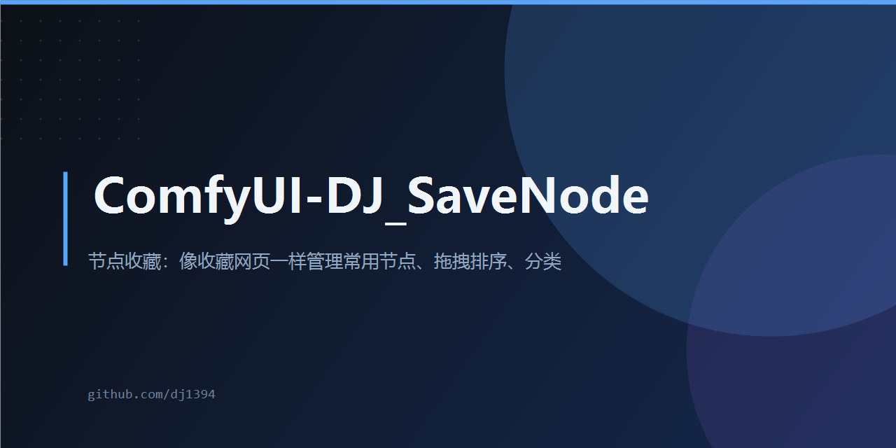

# 🐷 ComfyUI-DJ_SaveNode（节点收藏）

> 版本 `260904 1850` · 作者：DJ

像收藏网页一样收藏你的 ComfyUI 常用节点，支持节点组、拖拽排序与分类管理。

## ✨ 功能速览
- 🐷 悬浮入口：左下角可拖拽的猪猪按钮（距左 10px、距底 300px），随时展开收藏面板
- 📐 顶天立地面板：宽度 420px、撑满窗口高度，收藏项单行紧凑排列，深色配色（rgb 32/45/52 色系）
- 🔗 节点组收藏：选中多个已连接的节点，整体收藏并保留连接关系与相对位置
- ⭐ 快速收藏：右键节点或点击「收藏选中的节点/节点组」即可保存
- 📁 分类管理：创建 / 重命名 / 删除分类，收藏按分类查看
- 🖱️ 拖放恢复：从收藏列表单击或拖到画布即可恢复节点 / 节点组
- ↕️ 拖拽排序：收藏项在同一分类内拖动调整顺序，松手自动保存
- 📂 右键换组：收藏项上右键 → 选择目标分组即可移动（跨分组不能拖，只能右键）
- ✏️ 重命名 / 🗑️ 删除：收藏项支持重命名与删除（右键菜单里也有删除）
- 💾 本地存储：数据保存在插件目录 `favorites.json`，重启后仍然可用

## 一眼看懂
| | 能力 | 说明 |
|---|------|------|
| 单节点 | 📦 收藏 / 恢复 | 保存类型、尺寸、widget 值，点击或拖回画布 |
| 节点组 | 🔗 收藏 / 恢复 | 保存多节点相对位置与内部连线，恢复时自动重建连接 |
| 管理 | 分类 / 排序 / 换组 / 重命名 / 删除 | 面板内一键操作 |

## 安装
插件位于 `custom_nodes/ComfyUI-DJ_SaveNode/`：

```
custom_nodes/
└── ComfyUI-DJ_SaveNode/
    ├── __init__.py        ← 入口，注册路由
    ├── nodes.py           ← 空节点映射（功能全在前端）
    ├── server.py          ← 后端 API（收藏 / 分类增删改查 / 移动 / 排序）
    ├── requirements.txt   ← aiohttp>=3.8.0
    ├── favorites.json     ← 收藏数据（首次运行自动生成）
    └── web/
        ├── djsavenode.js  ← 前端：悬浮按钮 + 收藏面板
        └── style.css      ← 样式
```

重启 ComfyUI 后，点击左下角 🐷 按钮即可使用。

## 使用指南
1. **打开面板**：点击左下角 🐷 按钮（按钮可拖拽移动）
2. **收藏单个节点**：右键节点 → 「🐷 收藏到DJSaveNode」
3. **收藏节点组**：框选多个已连线节点 → 点击「⭐ 收藏选中的节点/节点组」→ 输入名称
4. **放回画布**：列表中单击或拖拽到画布即可恢复；节点组自动重建连接
5. **分类管理**：下拉选择分类过滤，➕ 新建 / ✏️ 重命名 / 🗑️ 删除（默认分类不可删改）
6. **调整顺序**：按住收藏项的 ☰ 区域在同一分类内上下拖动，出现指示线处松手即保存新顺序
7. **移动分组**：在收藏项上右键 → 菜单里点目标分组（当前分组带 ✓），收藏立即移过去

## 数据位置
`favorites.json` 位于插件根目录，存储收藏与分类数据。

## 作者
DJ
